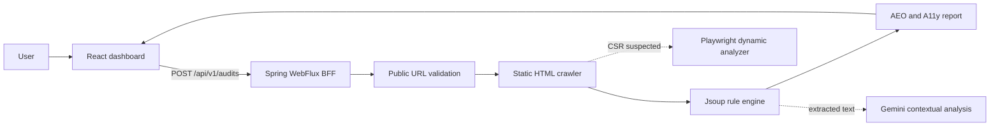

# AeoLens Architecture

## Repository layout

```text
AEOLens/
├─ frontend/            React, TypeScript, Vite, Tailwind CSS, Zustand
├─ backend/             Java 17, Spring Boot, WebFlux, Jsoup
├─ docs/                Architecture and portfolio documentation
├─ docker-compose.yml   Local full-stack container entry point
└─ README.md            Project overview and setup
```

## Request flow



Solid arrows are implemented. Dashed paths represent the planned dynamic-rendering and AI phases.

## Design decisions

- The frontend and backend live in one repository so a reviewer can inspect and run the complete product from one entry point.
- Each application owns its dependencies, build configuration, and container image.
- The backend acts as a BFF so target-site crawling and API credentials never move into the browser.
- Static rule checks run first. Browser rendering and AI calls are reserved for cases where they add information, keeping latency and cost bounded.
- Public-host validation rejects loopback and private-network targets before crawling.
